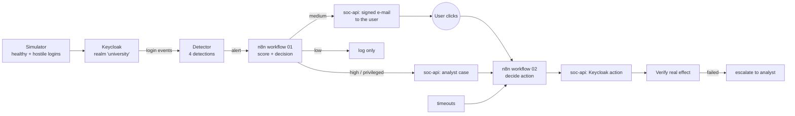

# "Was it you?" - Identity attack detection and user-in-the-loop response (SOAR project 4)

Keycloak (SSO) -> detector -> **n8n (SOAR)** -> question to the user by e-mail -> verified response.
Everything runs in Docker, free, no account needed.

## Architecture



| Service | URL | Role |
|---|---|---|
| Keycloak | http://localhost:8080 (admin/admin) | SSO, produces login events |
| n8n | http://localhost:5678 | SOAR: scoring and decisions (2 workflows) |
| soc-api | http://localhost:8000 | dashboard, signed dialogue, executes + verifies actions |
| Mailpit | http://localhost:8025 | the users' mailboxes |
| detector | (no UI) | 4 detections, `docker compose logs -f detector` |

## Run it

1. Install Docker Desktop (Windows/Mac) or Docker Engine + compose plugin (Linux). ~4 GB RAM free.
2. In this folder: `docker compose up -d --build`
3. Wait ~60 s (Keycloak is slow to start). Check: http://localhost:8080 and http://localhost:8000 respond.
4. **n8n first start**: open http://localhost:5678, create the owner account (any e-mail/password, local only).
   Workflows "01" and "02" must be listed and **Active**. If not: Workflows > Import from file
   (`n8n/workflows/*.json`) and toggle Active on both.
5. Open the dashboard http://localhost:8000 and Mailpit http://localhost:8025 side by side.
6. Run the scenarios (below), or everything at once: `docker compose run --rm sim simulate.py all`

## Scenarios (what to show in the demo)

Always start with `docker compose run --rm sim simulate.py warmup` (baseline: each user signs in from their own campus IP).

| Command | Attack | Expected |
|---|---|---|
| `simulate.py legit` | healthy day with typos | **no alert** (false-positive test) |
| `simulate.py bruteforce` | 8 bad passwords on `erin` | alert brute_force, score ~50 -> **e-mail to erin** |
| `simulate.py travel` | `bob` campus then London in 1 s | impossible_travel -> e-mail to bob |
| `simulate.py legit_travel` | same, for `carol` | e-mail; click **Yes** -> closed, no action |
| `simulate.py spray` | 3 passwords x 7 accounts | spraying (log only) + `dave` (weak password) compromised -> success_after_failures score ~75 -> **analyst case** on dashboard |
| `simulate.py privileged` | brute force on `prof.ben` | always **analyst case** (never automatic) |

Open the e-mail in Mailpit, click the link, press **No, it was not me**. Then in the dashboard: status
`contained_hard`, timeline shows `sessions_left=0`. Prove it: `docker compose run --rm sim simulate.py check erin Str0ng-Pass#erin`
-> sign-in refused (account must reset password + MFA). **Undo** button restores the account.
Do nothing on a question for 2 min -> sessions closed anyway (soft). Do nothing on an analyst case for 3 min -> soft only.

## How decisions are made (human-control matrix)

| Situation | Who decides | Automatic action | Reversible? |
|---|---|---|---|
| score < 30 | nobody | log only | n/a |
| 30-69, user has mailbox | the **user** (signed link, single use, expires) | yes -> close; no -> sessions closed + password reset + MFA | Undo button |
| user silent | rule | sessions closed only (account stays enabled) | sessions: re-login |
| >= 70, or privileged account | the **analyst** | nothing until approved | lock / reset undoable |
| analyst silent | rule | soft containment only, never a lock | yes |
| account **lock** | analyst only | forbidden to automate | Undo |

Score = base per attack type + 30 privileged + 15 never-seen IP + 10 high count + 20 bad IP reputation (optional AbuseIPDB) + 5 off-hours. Every point is
written in the alert (`reasons`). It lives in the n8n node **Score risk**: edit it there.

## Evaluation

`ANALYST_TTL=30 CHALLENGE_TTL=30 docker compose up -d` then `docker compose run --rm sim evaluate.py`
(sim uses `entrypoint python`, so: `docker compose run --rm sim evaluate.py`). It replays every scenario, answers the
e-mails through Mailpit, and prints detection rate, false positives, detection delay, alert->action delay,
users disturbed, versus a manual baseline (`MANUAL_BASELINE_S`, default 900 s, an assumption to justify in your report).

## Project layout

```
docker-compose.yml        the whole stack
keycloak/realm-university.json   9 users, group Privileged, native brute-force protection OFF (we detect ourselves)
n8n/workflows/            01 triage, 02 decision+response+verification (importable)
soc/detector.py           4 detections: brute force, spraying, success-after-failures, impossible travel
soc/api.py                signed dialogue, Keycloak actions, verification, undo, dashboard, timeouts
soc/simulate.py           traffic generator      soc/evaluate.py   automated metrics
```

## Answering the "extension" question: what if an attacker answers "it's me"?

Mitigations already in place / to discuss: the link only goes to the mailbox on file (not to the session that triggered the alert);
single-use + expiry; "yes" never whitelists the IP or lowers future scores; privileged accounts never rely on the user's answer.
To go further: require MFA step-up before accepting "yes", or accept "yes" only from a device already known for that user.

## Limits to state honestly in your report

* Lab shortcuts: no auth on the dashboard, shared secret in the compose file, GeoIP is a tiny offline table, Keycloak in `start-dev`.
* The simulator spoofs the client IP via `X-Forwarded-For`, possible only because the lab trusts proxy headers.
* Detector polls the events API every 2 s (max 500 events per poll): fine for a lab, use an event listener/Kafka in production.
* Shared campus NAT would make "spraying/success-after-failures" noisy: thresholds and allow-lists are env variables (`BF_THRESHOLD`, `SPRAY_USERS`, ...).

## Troubleshooting

* `docker compose logs -f detector` shows alerts and Keycloak readiness. "poll error" in the first minute is normal.
* n8n image tag cannot be pulled: use any `n8nio/n8n:1.x` tag in `docker-compose.yml`.
* Workflows not active: import and activate them by hand (step 4). Test: `curl -X POST localhost:5678/webhook/idr-alert -H 'content-type: application/json' -d '{"alert_id":"t1","type":"brute_force","user":"erin","ip":"1.2.3.4","email":"erin@univ.test","user_id":null}'`
* Reset everything: `docker compose down -v`.
